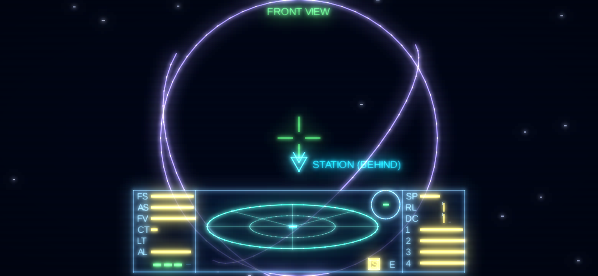
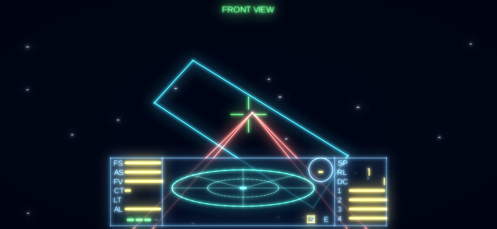
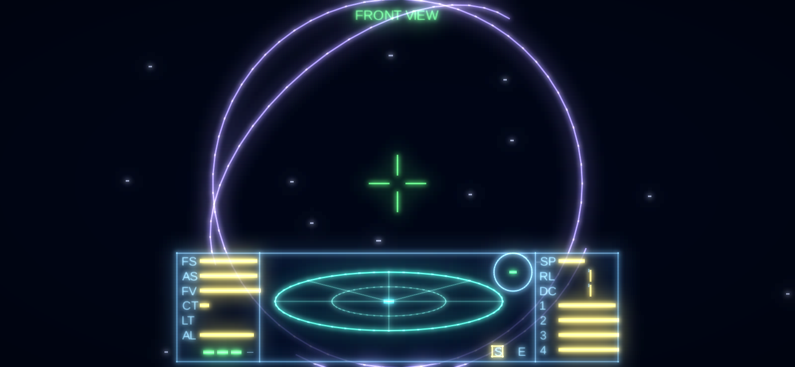
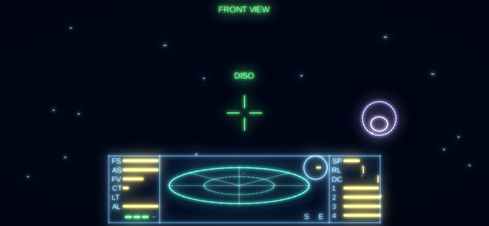
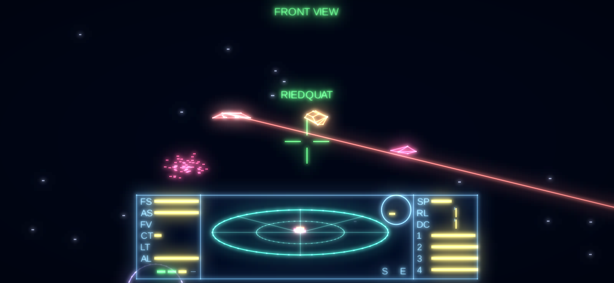
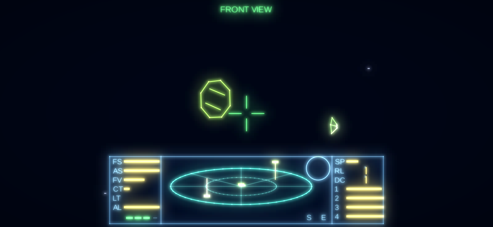
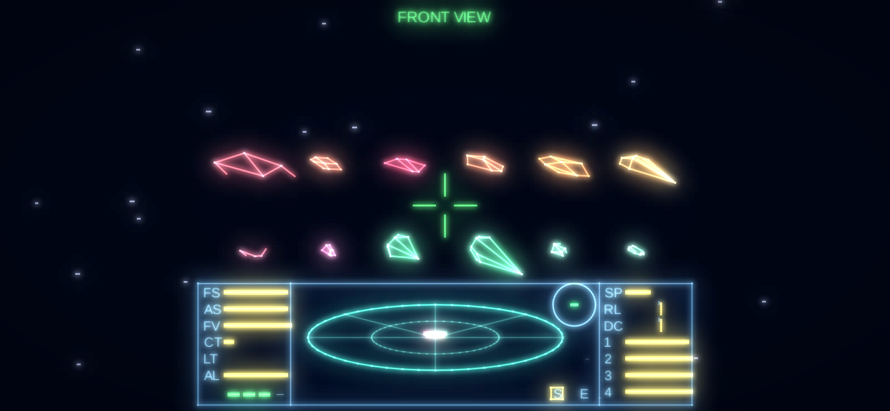
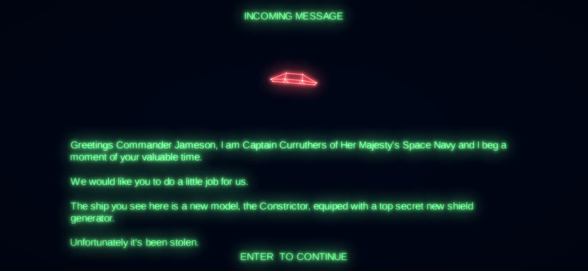
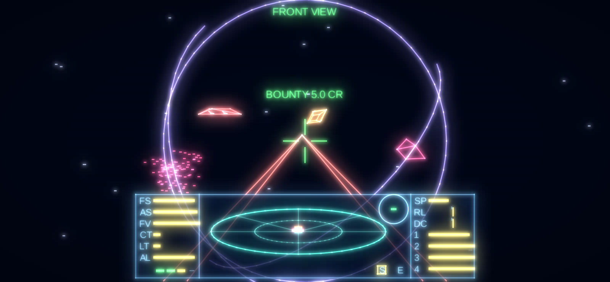

# Elite Android

Remake para Android do clássico **Elite** (1984 / MSX), com fidelidade aos algoritmos
originais e visual wireframe neon. Kotlin + LibGDX, com UI Android sobreposta.

Referências: *Mark Moxon's Elite Disassembly* e *Text Elite* (Ian Bell).

## Estrutura

```
core/     Kotlin/JVM puro — lógica do jogo + LibGDX core (testável sem Android SDK)
  galaxy/   Seed (6 bytes), GalaxyGenerator, PlanetSystem, GoatSoup (descrições)
  economy/  Commodities (QQ23), Market (GVL/TT151), Commander (CASH, QQ20, CRGO)
  save/     CommanderSave (arquivo do comandante), PreferencesStorage
  ships/    ShipBlueprint, DiscShips (30 modelos e os 16 arquivos de naves, gerado),
            OriginalShips (o míssil, gerado), ShipType (tabela XX21 + NEWB),
            ShipInstance (nosev/roofv/sidev + estado de combate)
  flight/   FlightModel (MVEIT, ISDK, SOLAR, WARP), Combat (TACTICS, surgimento, mísseis),
            PlayerShip, Planet, View (PLUT), HyperspaceCountdown (QQ22)
  hud/      Dashboard (DIALS, COMPAS), Scanner (SCAN — radar 3D "prato")
  input/    FlightInput (teclado do original), TouchControls (ponte UI Android → jogo)
  render/   WireframeProjector, NeonLineBatch, BloomRenderer, Stardust, LaunchTunnel, SpaceView
android/  App Android — AndroidLauncher (LibGDX view + overlays Android Views)
  ui/       FlightControlsOverlay, JoystickView, ThrottleView, NeonButton, NeonStyle,
            StationPanel (mercado/status/combustível/mapas/dados), ChartView (mapas estelares)
desktop/  Launcher LWJGL3 para desenvolvimento no PC e capturas de tela
tools/    extract_disc_ships.py (gera DiscShips.kt dos arquivos de naves da versão em disco)
          extract_ships.py (gera OriginalShips.kt — o míssil — do fonte da versão cassete)
```

## Etapas

1. ✅ Estrutura do projeto + gerador de galáxias Text Elite
2. ✅ Renderização 3D wireframe neon + Cobra Mk III e estação Coriolis
3. ✅ Física de voo, câmeras e docking
4. ✅ Scanner 3D e HUD
5. ✅ Controles touch
6. ✅ Economia, mercado e hiperespaço

## Build

Requisitos: JDK 17+, Android SDK (API 35).

```bash
./gradlew :core:test          # testes (não precisa de Android SDK)
./gradlew :desktop:run        # roda no PC
./gradlew :desktop:run --args="--screenshot shot.png --time 1.5 --view rear"   # captura e sai
./gradlew :android:installDebug
```

O módulo `:android` só é incluído quando há `ANDROID_HOME`/`ANDROID_SDK_ROOT` ou
`sdk.dir` em `local.properties`.

## Gerador de galáxias (Etapa 1)

- Semente inicial `5A4A 0248 B753`; `tweak()` = Fibonacci de 16 bits (4× por sistema).
- Galáxia seguinte: cada byte da semente rotacionado 1 bit à esquerda (8 galáxias, a 9ª = 1ª).
- Atributos de `makesystem()`: posição, economia, governo, tech level, população,
  produtividade, raio, nome (pares de letras) e descrição "goat soup".
- Espécie dominante conforme rotina TT25 do BBC Elite.
- `distance()` em décimos de ano-luz, idêntica ao Text Elite (inclusive `dy²/4` inteiro).

Valores verificados em teste: Lave (20,173), Rich Agri, Dictatorship, TL 5, 2.5 bi,
7000 M CR, raio 4116, *"Lave is most famous for its vast rain forests and the Lavian tree grub."*

## Renderização wireframe (Etapa 2)


- Modelos transcritos dos blocos VERTEX/EDGE do BBC Elite (Coriolis: 16 vértices,
  28 arestas, 14 faces; Cobra Mk III: 28 vértices, 38 arestas, 13 faces). Um teste
  confere que cada face é plana e convexa, validando a transcrição.
- Linhas ocultas como no LL9: a aresta aparece se uma de suas faces está voltada para
  o jogador; detalhes (motores, retro-foguetes, canhão) somem com a distância
  (XX4 = z/128) e, muito longe, a nave vira um ponto (visibility distance do modelo).
- Projeção x/z·largura (mesma razão do original: 256 px de vista → ~53° de campo).
- Jogador sempre na origem olhando para +z; naves orientadas por nosev/roofv/sidev.
- Neon: linhas como quads com núcleo quase branco + bloom em 2 níveis + scanlines.

## Voo, câmeras e atracação (Etapa 3)


Tudo conferido com o fonte comentado do Mark Moxon (`elite-source.asm`, versão cassete):

- **Rolagem/arfagem** (loop principal, parte 2): JSTX/JSTY → ALP1 = |JSTX|/8 (ou /4 a
  partir de 32), BET1 = (|JSTY|+4)/16 (metade abaixo de 3); α = ALP1/256 e β = BET1/256
  rad por ciclo. Teclado (DOKEY): ±7 na rolagem e ±14 na arfagem por ciclo, com
  amortecimento de 2 e 1 e auto-recentre.
- **Velocidade** DELTA 1..40; ao decolar, 12 (TT110).
- **MVEIT**: o jogador fica na origem; cada nave gira pela rolagem/arfagem do jogador
  (aproximação de ângulo pequeno), recebe z −= DELTA e tem os vetores girados por MVS4.
  Rotação própria via MVS5 (1/16 rad por ciclo); a estação tem contador de rolagem
  255 (gira para sempre no sentido anti-horário).
- **Câmeras** (PLUT): frente, trás, esquerda e direita trocam/invertem os eixos x e z.
- **Atracação** (ISDK): com a estação a < 128 unidades em cada eixo, atraca se ela não for
  hostil, apontar para nós (< 26°), estivermos no cone de 22° e a fenda estiver até
  36,6° da horizontal (|roofv_x| ≥ 80/96). Senão: abaixo de velocidade 5 é uma batida
  (para a nave e causa dano); acima, destruição. Para entrar é preciso casar a rotação
  da estação: rolagem com ALP1 = 16.
- **Túnel** de lançamento/atracação (LAUN/HFS2): circunferências que dobram de raio.

**Ritmo:** no BBC Micro a duração de um ciclo do loop principal variava com a carga;
usamos 12 ciclos/s (`FlightModel.TICK_RATE`), simulados em passos fixos de 1/60 s.

## Radar 3D e painel do cockpit (Etapa 4)


O painel segue o layout do BBC Elite num sistema virtual de 256 × 64, escalado e
centralizado embaixo (os lados ficam livres para os controles touch):

- **Radar "prato"** (SCAN): aparecem naves com |x|, |y|, |z| < 64·256. O ponto fica em
  x = 123 + x_hi; a base da haste em 220 − z_hi/4 (à frente = mais para cima no prato);
  a haste sobe/desce −y_hi/2, com o ponto limitado a 194..246. Sempre no referencial da
  vista frontal, qualquer que seja a câmera.
- **Barras** (DIALS/DILX, 16 passos): FS/AS = escudo/16, FV = combustível/4,
  CT/LT = temperatura/16, AL = altitude/16, SP = velocidade/2, e os bancos de energia
  1–4 = ENERGY/4 em blocos de 16 (o de baixo enche primeiro; o de cima vai até 15).
  Valores perigosos piscam em vermelho (PZW): escudos/combustível/energia abaixo de 3
  passos, temperaturas a partir de 11, velocidade a partir de 14.
- **RL / DC**: marcador na posição 8 ∓ ALP1/4 (rolagem) e 8 + β com o ajuste de 1 do
  original (arfagem).
- **Bússola** (COMPAS): vetor unitário até a estação ×96/10 (±9 px); amarela se à
  frente, verde se atrás.
- **Mísseis** (4 posições, o Cobra sai com 3) e bulbos **S** (estação por perto) e **E**.
- **Recarga** (loop principal parte 13): a cada 8 ciclos, com energia acima de 50%, os
  escudos sobem 1; depois a energia sobe 1.

Ainda não há planeta, então a altitude fica no máximo e a bússola aponta para a estação.

## Marcador de navegação



Uma ajuda que **não existe no original** (lá só há a bússola do painel), pensada para a
tela do celular: o alvo da bússola — a **estação** (ciano) ou, enquanto ela não surge, o
**planeta** (violeta) — ganha colchetes quando está na vista, ou uma **seta na borda** da
tela apontando para onde virar quando está fora dela, com "(BEHIND)" se estiver atrás.
Quando a estação surge, o marcador pisca por alguns segundos, "SPACE STATION" fica mais
tempo na tela e o "S" do painel acende bem destacado.

## Controles touch (Etapa 5)



Interface em Views Android sobrepostas à superfície LibGDX (`android/.../ui`), no mesmo
estilo neon, comunicando-se com o jogo por `TouchControls` (campos `@Volatile`):

| Controle | Toque | Teclado (desktop, teclas do original) |
|---|---|---|
| Rolar / arfar | manche flutuante na esquerda (aparece onde o polegar toca; puxar para baixo sobe o nariz) | `<` `>` / `X` `S` (ou setas) |
| Velocidade | acelerador vertical na direita (alvo 1–40; a nave acelera 1 por ciclo) | Espaço / `/` |
| Laser | **FIRE** (segurar) | `A` |
| Míssil | **MSL**: arma, trava (LOCK) e dispara; armado sem alvo, desarma | `T` arma, `M` dispara, `U` desarma |
| Hiperespaço | **HYPER** (mostra a contagem) | `H` |
| Vistas | **F R L D** no canto superior direito | F1–F4 ou 1–4 |
| Decolar | **LAUNCH** quando atracado | `L` ou Enter |
| Destino | **MAP** (em voo) ou aba **CHART** (atracado): toque num sistema | — |
| Salto no sistema | **JUMP** | `J` |

O manche funciona como o joystick analógico do original (define JSTX/JSTY direto); ao
soltá-lo, o amortecimento do teclado recentraliza aos poucos.

**Laser** (loop principal partes 3 e 4, LASLI, HITCH): o Cobra sai com laser de pulso só
na frente. Dispara com LASCT = 0 e temperatura < 242; cada tiro faz LASCT = 10 (contado a
50 Hz → 5 tiros/s, feixe visível nos 3 primeiros), GNTMP += 8 e energia −1; esfria 1 por
ciclo. Os feixes saem de x = 32/224 e 48/208 da borda inferior até um centro aleatório
±4 px. Acerta se a nave estiver à frente com x² + y² < "targetable area" do modelo —
atirar na estação a deixa **hostil**, e aí atracar vira colisão.

**Hiperespaço** (hyp/wW/QQ22): exige um destino diferente do sistema atual e combustível
suficiente ("RANGE?" se não houver); contagem de 15 na tela — o primeiro passo leva 15
ciclos e os seguintes 5 (85 ciclos). Ao zerar, toca o túnel do hiperespaço.

## Economia, mapas e o loop do hiperespaço (Etapa 6)




**Mercado** (QQ23, GVL, TT151 — idêntico ao `genmarket()` do Text Elite): 17 mercadorias
com preço base, fator econômico, quantidade base e máscara. A cada chegada sorteia-se um
byte QQ26; com variação = QQ26 AND máscara e produto = economia × fator:

    preço      = ((preço_base + variação + produto) AND 255) × 4      (décimos de Cr)
    quantidade = (qtd_base + variação − produto) AND 255 → 0 se bit 7 → AND 63

Itens alienígenas nunca estão à venda; compra = venda. O comandante padrão (JAMESON)
começa em Lave com 100.0 Cr, porão de 20 t, tanque cheio, e a oferta inicial gravada no
arquivo de comandante (QQ26 = 0). Compras checam estoque, porão (tnpr: itens 0–12 contam
em toneladas; ouro, platina e gemas até 200 cada) e dinheiro. Combustível: encher o
tanque custa 0.2 Cr por 0.1 LY (EQSHP).

**Mapas** (TT23/TT22): curto alcance com |dx| < 20 e |dy| < 38, x × 4 e y × 2 (raio do
círculo de combustível = combustível em décimos de LY), estrelas de raio 2 + bit 0 de
s2_hi; galáctico com os 256 sistemas em (x, y/2). Tocar escolhe o destino.

**Salto** (TT18 + SOLAR): gasta o combustível da distância, troca de sistema, sorteia o
novo mercado e monta o sistema: planeta à frente (z = 3..7 × 65536, deslocado para cima
e à direita ou para baixo e à esquerda) e sol atrás. **JUMP** (WARP) aproxima planeta e
sol em 65536 por vez, se não houver estação por perto. Perto do planeta (parte 14), a
estação surge a um raio de altitude sobre ele (planeta + 2·nosev), com a fenda voltada
para o planeta; o sol some (WPLS). A altitude (parte 15) é √(d² − 96²); bater no planeta
é fatal. A bússola aponta para o planeta e, na zona segura, para a estação.

**Planeta** (raio 24576): contorno + equador e meridiano, ou cratera (bit 1 do tech
level), girando 1/16 rad por ciclo. **Sol**: linhas horizontais com borda tremulante.

**Projeção:** a focal é altura × 256/192, o mesmo campo vertical do original (vista de
256 × 192); a tela larga só amplia a visão lateral.

## Naves inimigas e mísseis



O tráfego, a IA e os modelos vêm da **versão em disco** do BBC Elite (a cassete só tem 13
tipos de nave; ver [Naves da versão em disco](#naves-da-versão-em-disco)).

- **Surgimento** (loop principal do jogo, partes 2 e 3, a cada 256 ciclos): 13% de
  chance de comerciante, pedregulho, asteroide ou contêiner (até 3 "lixos" por perto);
  fora da zona segura, polícia com chance proporcional à carga ilegal (e ao FIST, se já
  houver polícia), e piratas (bandos de 1 a 4) ou um caçador solitário, sempre em
  anarquias e com menos frequência quanto mais seguro o governo.
- **IA** (TACTICS, a cada 8 ciclos por nave com IA): recarga, rolagem aleatória, fuga em
  cápsula com pouca energia (só quem tem uma), mísseis quando abaixo de metade da
  energia, laser quando apontada para nós (a menos de 32·256; acerta com ângulo menor
  que ~14°, dano = byte #19 / 2) e manobra de arfagem/rolagem em nossa direção (ou para
  longe, conforme a agressividade). Na zona segura, piratas perdem a agressividade.
- **Nosso laser** (HITCH): tira 15 de energia por tiro; ANGRY deixa o alvo agressivo e
  hostil; atingir uma nave "inocente" ou a estação deixa a estação hostil (ela passa a
  lançar Vipers); abater a polícia → fugitivo.
- **Mísseis**: armar procura um alvo na mira (indicador amarelo), trava (vermelho) e
  dispara a partir de (0, −28, 14) ao dobro da nossa velocidade. O míssil persegue o
  alvo; alvos com E.C.M. podem destruí-lo (6% por ciclo). Mísseis inimigos causam 250.
- **Abates**: explosão (DOEXP), recompensa em créditos, contagem para a classificação
  (Harmless … Elite) e 50% de chance de soltar contêineres. Colisões: 128 + energia/2.

## Witchspace e Thargoids



Em **0.78%** dos saltos (TT18: DORND ≥ 253) — ou sempre, segurando **CTRL** no
desktop no instante do salto — o hiperespaço falha (MJP) e caímos no **witchspace**:

- sem planeta, sol nem estação, e quase sem poeira estelar (NOSTM = 3);
- o combustível do salto é gasto, e a posição na galáxia passa a ser a do sistema de
  partida com os bits 0..5 do y invertidos — os mapas mostram esse ponto vazio, e o
  destino continua escolhido;
- surgem **4 Thargoids** (IA %11111111: agressividade máxima e E.C.M.), cada um com um
  **Thargon** (GTHG); nada mais aparece depois disso;
- abates contam para a classificação, mas **não há recompensas** no witchspace;
- não dá para atracar nem fazer o salto "J", e usar a cápsula de fuga é **fatal**;
- para sair, basta um hiperespaço normal (se ainda houver combustível) ou o
  hiperpropulsor galáctico.

Os modelos do Thargoid (disco octogonal, 20 vértices, 240 de energia, recompensa de
50 Cr) e do Thargon (que no original reaproveita as arestas do contêiner) são extraídos
do fonte. No TACTICS, o Thargoid nunca foge em cápsula e, em vez de mísseis, **lança
Thargons** (até 6). Sem nenhum Thargoid por perto, os Thargons perdem o E.C.M. e ficam à
deriva com metade da velocidade; com os coletores, viram **Alien Items**. Como na versão
em disco, fora das missões os Thargoids só aparecem no witchspace (que carrega o
arquivo de naves D).

## Naves da versão em disco



*Krait, Adder, Gecko, Cobra Mk I, Asp Mk II e Fer-de-Lance; Moray, Worm, Boa, Anaconda,
Shuttle e Transporter.*

A versão em disco acrescentou 17 modelos aos 12 da cassete (e variantes piratas do
Cobra Mk III e da Python). Os modelos (VERTEX, EDGE e
FACE, com as normais e as distâncias de visibilidade das faces do original) são
extraídos dos 16 arquivos de naves `elite-ships-a..p.asm` por
`tools/extract_disc_ships.py`:

| Papel | Naves |
|---|---|
| Estação | Coriolis; **Dodecaedro** nos sistemas de tech level alto |
| Lixo | cápsula de fuga, **placa de liga**, contêiner, **pedregulho**, asteroide, **fragmento** |
| Comerciantes | **Shuttle**, **Transporter**, Cobra Mk III, Python, **Boa**, **Anaconda** |
| Polícia | Viper |
| Piratas | Sidewinder, Mamba, **Krait**, **Adder**, **Gecko**, **Cobra Mk I**, **Worm**, Cobra Mk III, **Asp Mk II**, Python |
| Caçadores de recompensas | **Fer-de-Lance** (e a Viper) |
| Alienígenas | Thargoid, Thargon |

- **Arquivos de naves (LOMOD)**: a memória do BBC só comportava parte das naves, então
  cada lançamento ou chegada carrega um dos 16 arquivos "A" a "P" — 2 bits aleatórios, um
  pelo governo (≥ 3) e um pelo tech level (≥ 10). Só as naves do arquivo carregado podem
  surgir, e a estação dos sistemas avançados é a Dodecaedro. Um bando sorteia tipos de
  Sidewinder até Cobra Mk III; se o tipo não está no arquivo, tenta o anterior.
- **Flags NEWB** (tabela E%): comerciante, caçador de recompensas, hostil, pirata,
  atracando, inocente, polícia e "tem cápsula de fuga". A bolha local tem 12 posições
  (NOSH).
- **Comerciantes** (MTT4): Cobra Mk III, Python, Boa ou Anaconda; metade ganha IA e vai
  **atracar** (DOCKIT): segue para o planeta, vai até o ponto ideal 768 unidades à frente
  da fenda, vira para a estação devagar e, alinhada, entra e some. Os demais seguem
  para o planeta. Atirar neles (inocentes) deixa a estação hostil.
- **Estação**: de vez em quando lança um **Shuttle** ou um **Transporter** (que seguem
  para o planeta); hostil, lança Vipers.
- **Anaconda**: 22% de chance, a cada decisão, de lançar um **Worm**.
- **Caçadores de recompensas**: neutros, até o nosso status legal chegar a 40 (infrator
  grave ou fugitivo) — aí atacam.
- **Coletores**: placas de liga viram **Alloys**, fragmentos viram **Minerals**,
  cápsulas viram **Slaves** e Thargons viram **Alien Items** (byte #0 do modelo).

A **Moray** está nos arquivos de naves, mas — como no original — nenhuma rotina de
surgimento chega ao tipo 28, então ela nunca aparece.

## Missões



As duas missões da versão em disco, com o byte TP do original (DOENTRY decide, a cada
atracação, se uma missão começa, avança ou termina). As mensagens aparecem como
"INCOMING MESSAGE" — no briefing da missão 1, o Constrictor gira acima do texto.

**Missão 1 — o Constrictor roubado**
- Começa ao atracar com **256 abates** ou mais, nas galáxias 1 ou 2. O capitão da marinha
  (Curruthers, Fosdyke Smythe…) conta que o protótipo foi roubado do estaleiro de Xeer.
- Pistas: com a missão em andamento, o "Data on System" de vários sistemas troca a
  descrição do planeta por um recado (Xeer → Reesdice → Arexe; na galáxia 2, Errius →
  Inbibe → Ausar → Usleri → Orarra…), com as palavras sorteadas do original.
- O Constrictor está na **galáxia 2, no sistema em (144, 33)** (lá o jogo carrega o
  arquivo de naves G, o único com ele): ele surge no lugar de um caçador solitário, com
  E.C.M. e agressividade 60. **Só o laser militar** o fere, e com um quarto da potência.
- Destruído, ao atracar: **5000 Cr** e 256 abates de bônus.

**Missão 2 — os planos dos Thargoids**
- Com a missão 1 cumprida e **1280 abates**, na galáxia 3: a marinha pede que você vá a
  **Ceerdi**, onde o Agente Blake entrega os planos das Hive Worlds.
- Carregando os planos: os arquivos de naves passam a ser os com Thargoids (C ou D) e
  cada rodada de surgimento tem 22% de chance de um Thargoid.
- Entregue-os em **Birera**: a recompensa é a **unidade de energia da marinha** (recarga
  tripla) e 256 abates de bônus.

Também da versão em disco: a cada 256 abates, "RIGHT ON COMMANDER!"; abates a laser soltam
placas de liga e contêineres; e o **laser de mineração** parte asteroides em fragmentos.
O estado das missões vai no jogo salvo (versão 3).

## Som

O som é o do BBC Micro **emulado**, não gravado: `audio/BeebSound` imita o chip SN76489
(três canais de onda quadrada e um de ruído, com o registrador de deslocamento de 15
bits e a atenuação de 2 dB por nível) comandado como pelo sistema operacional do BBC —
os comandos SOUND (canal, amplitude, altura em quartos de semitom, duração em vinteavos
de segundo, fila ou "flush") e ENVELOPE (três seções de altura e as fases de ataque,
decaimento, sustentação e liberação, a 100 Hz). `audio/SoundEffects` tem a tabela **SFX**
e os quatro envelopes do loader (E%), e as rotinas NOISE, EXNO, EXNO3 e BEEP:

| Som | Quando |
|---|---|
| Laser (envelope 1) | cada tiro nosso — o de feixe reinicia o som a cada ciclo |
| Acerto / abate (EXNO) | ruído mais baixo quanto mais longe a nave (z_hi) |
| Laser nos atingindo (envelope 2) | só sem E.C.M. ligado |
| Explosão (EXNO3) | morte, colisão, batida na estação, contêiner destruído, dano que passa dos escudos, míssil nos atingindo — o ruído segue a altura do canal 1, varrida pelo envelope 3 |
| Lançamento | mísseis (nossos e inimigos), decolagem e atracação |
| Hiperespaço (envelope 2 no canal de ruído) | ao entrar no túnel |
| E.C.M. (envelope 4) | do acionamento até o fim (nosso ou do inimigo) |
| Bipe curto | trava do míssil, ENERGY LOW, FUEL SCOOPS ON, erros nas telas da estação |
| Bipe longo | desarmar o míssil, salto "J" recusado |

O áudio sai por um `AudioDevice` do LibGDX (Android e desktop), numa thread própria.
**SOUND ON/OFF** fica na aba STATUS (lembrado entre sessões). Para ouvir todos os efeitos
em sequência num WAV: `./gradlew :desktop:run --args="--sound-demo sons.wav"`.

## Loja de equipamentos



A aba **EQUIP** é o "Equip Ship" (EQSHP) da versão em disco: os itens à venda dependem
do tech level do sistema (os primeiros `tek + 3`; a partir de 12, todos os 14), com os
preços da tabela PRXS.

| Item | Preço | Efeito |
|---|---|---|
| Fuel | 0.2 Cr / 0.1 LY | enche o tanque (7.0 LY) |
| Missile | 30 Cr | até 4 ("ALL PRESENT") |
| Large Cargo Bay | 400 Cr | porão de 20 t → 35 t |
| E.C.M. System | 600 Cr | **E** / botão ECM: destrói todos os mísseis por 32 ciclos, gastando 1 de energia por ciclo |
| Pulse Laser | 400 Cr | potência 15, 5 tiros/s (escolha a vista FRONT/REAR/LEFT/RIGHT) |
| Beam Laser | 1000 Cr | dispara a cada ciclo do loop principal (esquenta mais rápido) |
| Fuel Scoops | 525 Cr | combustível perto do sol (CABTMP ≥ 224: +velocidade/8) e contêineres que passem **por baixo** da nave (item aleatório; cápsulas viram escravos) |
| Escape Pod | 1000 Cr | **ESC** / EJECT: volta à estação com um Cobra novo e tanque cheio, perdendo a carga; a ficha fica limpa |
| Energy Bomb | 900 Cr | **TAB** / BOMB: destrói todas as naves por perto, menos a estação (uso único) |
| Energy Unit | 1500 Cr | recarga de energia em dobro |
| Docking Computers | **de fábrica** (1000 Cr no original) | **C** / DOCK: atracação imediata na zona segura (estação não hostil) |
| Galactic Hyperspace | 5000 Cr | **CTRL-H** / G-HYP: salto para a galáxia seguinte (8 → 1), chegando ao sistema mais perto de (96, 96); limpa a ficha (uso único) |
| Military Lasers | 6000 Cr | como o de feixe, com potência 23 — o único que fere o Constrictor |
| Mining Lasers | 800 Cr | pulsos lentos de potência 50; asteroides destruídos por ele se partem em fragmentos |

Qualquer laser substitui o da vista, devolvendo o preço do antigo; só o mesmo tipo é
recusado ("LASER PRESENT").

Em voo, os botões dos equipamentos instalados aparecem no alto da tela. O **sol** também
esquenta a cabine (barra CT): perto demais (A < 30, com A = Σ coordenada_hi²/256), a nave
queima. A tela STATUS lista o equipamento, e o jogo salvo guarda tudo — saves antigos
continuam carregando, com o equipamento de fábrica.

## Jogo salvo

Como no original, o comandante é gravado **quando atracado**: automaticamente ao
atracar, ao sair do app atracado, ou pelos botões **SAVE GAME** / **SAVE & EXIT** da aba
STATUS. Ao abrir o app, o último comandante volta atracado na mesma estação, com
dinheiro, porão, combustível, mísseis, abates, status legal, destino escolhido e o
mercado daquela visita (QQ26 + oferta). **NEW GAME** (dois toques) recomeça como JAMESON
em Lave. Se a nave for destruída, o último comandante salvo é recarregado.

O arquivo é texto `chave=valor` versionado, guardado nas Preferences do LibGDX
(SharedPreferences no Android; `~/.prefs/elite-commander` no desktop).
