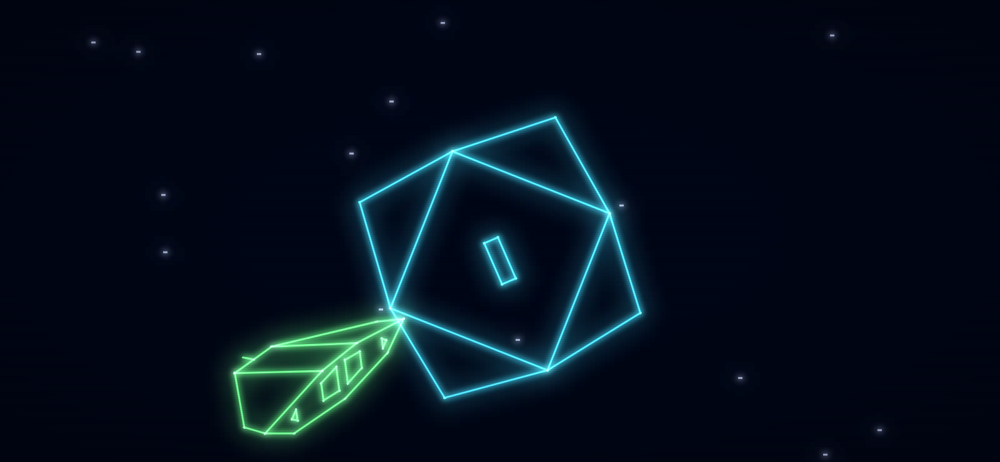
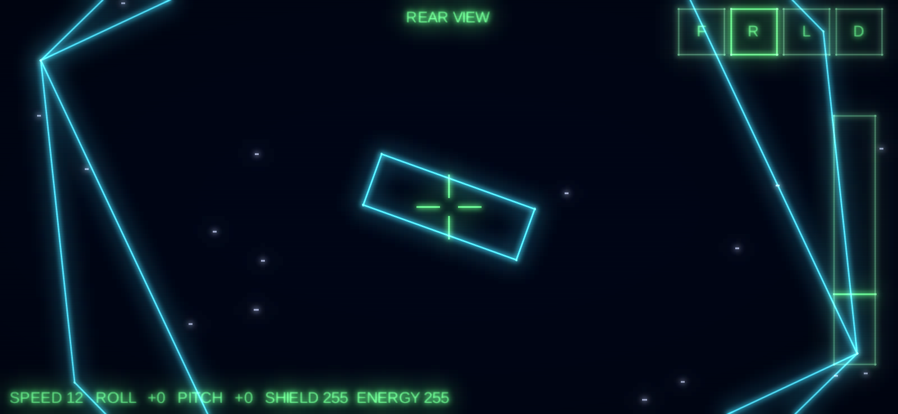
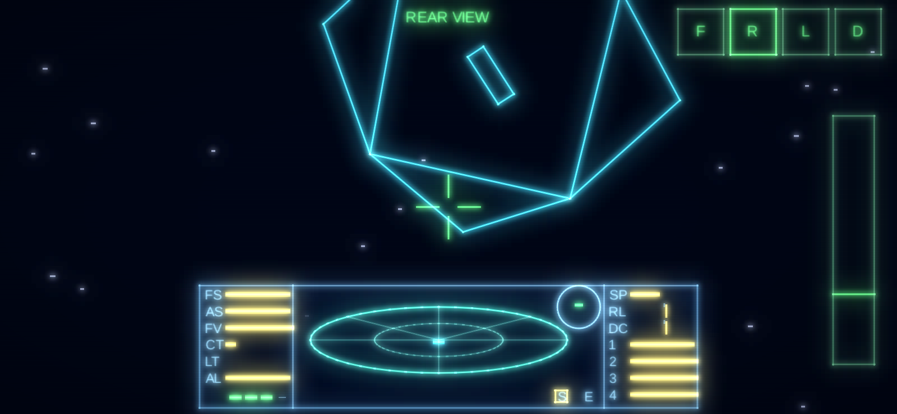

# Elite Android

Remake para Android do clássico **Elite** (1984 / MSX), com fidelidade aos algoritmos
originais e visual wireframe neon. Kotlin + LibGDX, com UI Android sobreposta.

Referências: *Mark Moxon's Elite Disassembly* e *Text Elite* (Ian Bell).

## Estrutura

```
core/     Kotlin/JVM puro — lógica do jogo + LibGDX core (testável sem Android SDK)
  galaxy/   Seed (6 bytes), GalaxyGenerator, PlanetSystem, GoatSoup (descrições)
  ships/    ShipBlueprint, Blueprints (Coriolis, Cobra Mk III), ShipInstance (nosev/roofv/sidev)
  flight/   FlightModel (MVEIT, ISDK), PlayerShip (JSTX/JSTY, α/β, DELTA), View (PLUT)
  hud/      Dashboard (DIALS, COMPAS), Scanner (SCAN — radar 3D "prato")
  input/    FlightInput (teclado do original + toque provisório)
  render/   WireframeProjector, NeonLineBatch, BloomRenderer, Stardust, LaunchTunnel, SpaceView
android/  App Android — AndroidLauncher (LibGDX view + overlays Android Views)
desktop/  Launcher LWJGL3 para desenvolvimento no PC e capturas de tela
```

## Etapas

1. ✅ Estrutura do projeto + gerador de galáxias Text Elite
2. ✅ Renderização 3D wireframe neon + Cobra Mk III e estação Coriolis
3. ✅ Física de voo, câmeras e docking
4. ✅ Scanner 3D e HUD
5. ⏳ Controles touch
6. ⏳ Economia, mercado e hiperespaço

## Build

Requisitos: JDK 17+, Android SDK (API 35).

```bash
./gradlew :core:test          # testes (não precisa de Android SDK)
./gradlew :desktop:run        # roda no PC
./gradlew :desktop:run --args="--screenshot shot.png --time 1.5 --view rear"   # captura e sai
./gradlew :android:installDebug
```

O módulo `:android` só é incluído quando há `ANDROID_HOME`/`ANDROID_SDK_ROOT` ou
`sdk.dir` em `local.properties`.

## Gerador de galáxias (Etapa 1)

- Semente inicial `5A4A 0248 B753`; `tweak()` = Fibonacci de 16 bits (4× por sistema).
- Galáxia seguinte: cada byte da semente rotacionado 1 bit à esquerda (8 galáxias, a 9ª = 1ª).
- Atributos de `makesystem()`: posição, economia, governo, tech level, população,
  produtividade, raio, nome (pares de letras) e descrição "goat soup".
- Espécie dominante conforme rotina TT25 do BBC Elite.
- `distance()` em décimos de ano-luz, idêntica ao Text Elite (inclusive `dy²/4` inteiro).

Valores verificados em teste: Lave (20,173), Rich Agri, Dictatorship, TL 5, 2.5 bi,
7000 M CR, raio 4116, *"Lave is most famous for its vast rain forests and the Lavian tree grub."*

## Renderização wireframe (Etapa 2)



- Modelos transcritos dos blocos VERTEX/EDGE do BBC Elite (Coriolis: 16 vértices,
  28 arestas, 14 faces; Cobra Mk III: 28 vértices, 38 arestas, 13 faces). Um teste
  confere que cada face é plana e convexa, validando a transcrição.
- Linhas ocultas como no LL9: a aresta aparece se uma de suas faces está voltada para
  o jogador; detalhes (motores, retro-foguetes, canhão) somem com a distância
  (XX4 = z/128) e, muito longe, a nave vira um ponto (visibility distance do modelo).
- Projeção x/z·largura (mesma razão do original: 256 px de vista → ~53° de campo).
- Jogador sempre na origem olhando para +z; naves orientadas por nosev/roofv/sidev.
- Neon: linhas como quads com núcleo quase branco + bloom em 2 níveis + scanlines.

## Voo, câmeras e atracação (Etapa 3)



Tudo conferido com o fonte comentado do Mark Moxon (`elite-source.asm`, versão cassete):

- **Rolagem/arfagem** (loop principal, parte 2): JSTX/JSTY → ALP1 = |JSTX|/8 (ou /4 a
  partir de 32), BET1 = (|JSTY|+4)/16 (metade abaixo de 3); α = ALP1/256 e β = BET1/256
  rad por ciclo. Teclado (DOKEY): ±7 na rolagem e ±14 na arfagem por ciclo, com
  amortecimento de 2 e 1 e auto-recentre.
- **Velocidade** DELTA 1..40; ao decolar, 12 (TT110).
- **MVEIT**: o jogador fica na origem; cada nave gira pela rolagem/arfagem do jogador
  (aproximação de ângulo pequeno), recebe z −= DELTA e tem os vetores girados por MVS4.
  Rotação própria via MVS5 (1/16 rad por ciclo); a estação tem contador de rolagem
  255 (gira para sempre no sentido anti-horário).
- **Câmeras** (PLUT): frente, trás, esquerda e direita trocam/invertem os eixos x e z.
- **Atracação** (ISDK): com a estação a < 128 unidades em cada eixo, atraca se ela não for
  hostil, apontar para nós (< 26°), estivermos no cone de 22° e a fenda estiver até
  36,6° da horizontal (|roofv_x| ≥ 80/96). Senão: abaixo de velocidade 5 é uma batida
  (para a nave e causa dano); acima, destruição. Para entrar é preciso casar a rotação
  da estação: rolagem com ALP1 = 16.
- **Túnel** de lançamento/atracação (LAUN/HFS2): circunferências que dobram de raio.

**Ritmo:** no BBC Micro a duração de um ciclo do loop principal variava com a carga;
usamos 12 ciclos/s (`FlightModel.TICK_RATE`), simulados em passos fixos de 1/60 s.

**Controles provisórios** (a interface touch definitiva é a Etapa 5):

| | Teclado (desktop) | Toque |
|---|---|---|
| Rolar | `<` `>` (ou `,` `.` / ← →) | arrastar na metade esquerda |
| Arfar | `X` sobe o nariz, `S` desce (ou ↓ ↑) | idem (puxar para baixo sobe o nariz) |
| Velocidade | Espaço acelera, `/` desacelera | faixa à direita |
| Vistas | F1–F4 ou 1–4 | botões F R L D |
| Decolar | `L` ou Enter | botão LAUNCH |

## Radar 3D e painel do cockpit (Etapa 4)



O painel segue o layout do BBC Elite num sistema virtual de 256 × 64, escalado e
centralizado embaixo (os lados ficam livres para os controles touch):

- **Radar "prato"** (SCAN): aparecem naves com |x|, |y|, |z| < 64·256. O ponto fica em
  x = 123 + x_hi; a base da haste em 220 − z_hi/4 (à frente = mais para cima no prato);
  a haste sobe/desce −y_hi/2, com o ponto limitado a 194..246. Sempre no referencial da
  vista frontal, qualquer que seja a câmera.
- **Barras** (DIALS/DILX, 16 passos): FS/AS = escudo/16, FV = combustível/4,
  CT/LT = temperatura/16, AL = altitude/16, SP = velocidade/2, e os bancos de energia
  1–4 = ENERGY/4 em blocos de 16 (o de baixo enche primeiro; o de cima vai até 15).
  Valores perigosos piscam em vermelho (PZW): escudos/combustível/energia abaixo de 3
  passos, temperaturas a partir de 11, velocidade a partir de 14.
- **RL / DC**: marcador na posição 8 ∓ ALP1/4 (rolagem) e 8 + β com o ajuste de 1 do
  original (arfagem).
- **Bússola** (COMPAS): vetor unitário até a estação ×96/10 (±9 px); amarela se à
  frente, verde se atrás.
- **Mísseis** (4 posições, o Cobra sai com 3) e bulbos **S** (estação por perto) e **E**.
- **Recarga** (loop principal parte 13): a cada 8 ciclos, com energia acima de 50%, os
  escudos sobem 1; depois a energia sobe 1.

Ainda não há planeta, então a altitude fica no máximo e a bússola aponta para a estação.
